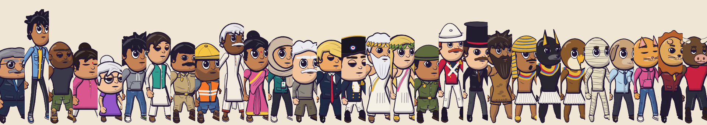

# Inkbone



I built Inkbone to make cartoon videos in code. You write a scene as JSON, and it renders stills, contact sheets or MP4.

Characters are flat 2D drawings on a real 3D skeleton, so they turn, walk and act properly. There are no image assets. Every frame comes from code, and the same time and seed always give the same frame.

## What you get

- 29 ready characters, from everyday people to Einstein, Napoleon, Greek gods, soldiers, a mummy and animal-headed folks
- A character generator with body types, hair, outfits, hats, faces and 7 animal heads
- 70 moves: walks, talking, gestures, reactions, fights, props, plus two-person moves like hugs and handshakes
- 2D sets and 3D worlds with camera moves, lighting and time of day
- Two styles: round and stickman
- Vertical Shorts with `"size": "1080x1920"`, framed on whoever is talking
- Dialogue lines that turn into captions, with the speakers acting them out
- A dashboard to browse everything and try films live

## Quick start

You need Node 18+, and ffmpeg for video.

```bash
git clone https://github.com/Amansingh-afk/inkbone.git
cd inkbone
npm install
npx playwright-core install chromium
```

Render the example film:

```bash
node bin/inkbone.mjs validate examples/kitchen.json
node bin/inkbone.mjs sheet examples/kitchen.json
node bin/inkbone.mjs render examples/kitchen.json
```

Open the dashboard:

```bash
node tools/serve.mjs
```

Then go to http://127.0.0.1:8766.

## A film

```json
{
  "mode": "2d",
  "characters": { "zeus": "zeus", "pup": "dogman" },
  "scenes": [
    {
      "set": "kitchen", "dur": 4,
      "actors": [
        { "who": "zeus", "x": 640, "y": 940, "track": [{ "at": 0, "move": "talk-mix", "facing": 0.6 }] },
        { "who": "pup", "x": 1280, "y": 940, "track": [{ "at": 0, "move": "listen", "facing": -0.6 }] }
      ]
    }
  ]
}
```

Every field is in [the film reference](skills/inkbone/reference/film.md). Every name you can use is in [the catalog](skills/inkbone/reference/catalog.md), or run `node bin/inkbone.mjs list`.

## Commands

| Command | Does |
|---|---|
| `list [word]` | Search moves, characters, outfits, sets and more |
| `look <character>` | One character from six angles |
| `validate film.json` | Check a film, with fixes for typos |
| `still film.json --t 2` | One frame |
| `sheet film.json` | Frames from the whole film on one image |
| `render film.json` | MP4 |

Outputs land next to the film unless you pass `--out`.

## Use it in your project

```bash
npm install github:Amansingh-afk/inkbone#v0.4.0
npx inkbone render film.json
```

Or in code:

```js
import { Ink, CAST, drawAct } from 'inkbone';

function frame(ctx, t) {
  drawAct(new Ink(ctx, { t }), CAST.zeus, 'wave', t, { x: 960, y: 940, scale: 1.4 });
}
```

## For AI agents

Inkbone ships with a skill that teaches an agent to write films and check its own renders. Claude Code reads [skills/inkbone](skills/inkbone/SKILL.md) as a plugin. Other agents read [AGENTS.md](AGENTS.md).

## Adding things

New moves, outfits, hats, heads and sets are plain code in `src/`. See [the extending guide](skills/inkbone/reference/extending.md), and run `node tools/check.mjs` before you commit.

## License

MIT
